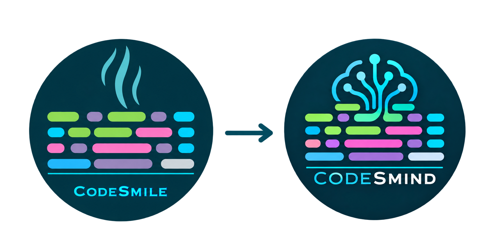

<p align="center">
  
</p>

<h1 align="center">CodeSmind</h1>
<p align="center"><strong>Extending CodeSmile with LLM-Based Code Smell Detection, Reasoning, and Prompt Engineering</strong></p>
<p align="center"><em>From code smells to code understanding.</em></p>

---

## Overview

**CodeSmind** is a research-oriented tool for detecting **machine learning (ML)-specific code smells** in Python projects. It builds on **CodeSmile** by retaining the original code analysis components while extending the graphical workflow for **large language model (LLM)-based detection**, **prompt engineering**, and **model/provider configuration**.

CodeSmind is intended for developers and researchers who want to inspect Python code, experiment with LLMs for code smell detection, and examine the results of different models and smell-specific prompts.

**Important scope distinction:** This repository contains both the existing CodeSmile implementation and the CodeSmind extensions. The primary focus of the CodeSmind work is the **GUI-supported LLM detection and prompt engineering workflow**; inherited components are not presented as newly developed CodeSmind features.

## What CodeSmind Adds

The CodeSmind extensions focus on the following capabilities:

- **LLM-based detection through the graphical interface:** run code smell analyses using a selected LLM provider and a smell-specific prompt.
- **Local and API-based LLM support:** work with configured local models (including Ollama models) or API providers, depending on the available configuration.
- **Model and provider management:** discover/select local Ollama models and configure supported providers through the application workflow.
- **Prompt engineering:** create or refine a *draft* prompt, test it against Python files, and promote it to the *default* prompt when ready.
- **Code smell catalog management:** edit descriptions and manage supported smell definitions without modifying detection source code for every new LLM-based smell.
- **Explainability-oriented outputs:** retain structured findings and, where provided by the model and supported by the selected workflow, reasoning or explanatory information.
- **Result inspection:** generate files useful for examining normalized findings and raw model responses.

LLM results depend on the **model**, **prompt**, **input code**, and **generation settings**. A generated finding or explanation should be reviewed rather than treated as automatically verified.

## Choose Your Workflow

| Goal | Entry point | Recommended for |
| --- | --- | --- |
| Detect code smells from the main desktop interface | `python -m gui.gui_runner` | First-time users and GUI-based analysis |
| Experiment with smell-specific LLM prompts | `python -m prompt_engineering.prompt_engineering_gui` | Prompt development and comparison |
| Manage the code smell catalog | `python -m gui.manage_code_smells_gui` | Adding or updating LLM-detectable smells |
| Run the original static analyzer from the terminal | `python -m cli.cli_runner` | Command-line and batch analyses |

The inherited web application and earlier fine-tuned-model research are described separately below; they are **not required** to start with the main CodeSmind GUI workflow.

---

## Requirements

- **Python 3.11**.
- Python dependencies listed in `requirements.txt`.
- **For local LLM use:** Ollama installed and available on your machine, with the required Python client and a compatible model.
- **For API-based LLM use:** access to a supported service and the corresponding credentials.

```bash
pip install -r requirements.txt
```

> **Hardware note:** Local models run on the user's computer. Memory requirements and response times depend on model size, quantization, context length, and available CPU/GPU resources. An API provider may be preferable when local hardware is limited.

## Installation

Clone the repository:

```bash
git clone https://github.com/alessraia/CodeSmind.git
cd CodeSmind
```

Create and activate a virtual environment (recommended):

**Windows (PowerShell):**

```powershell
py -3.11 -m venv .venv
.\.venv\Scripts\Activate.ps1
python -m pip install -r requirements.txt
```

**macOS / Linux:**

```bash
python3.11 -m venv .venv
source .venv/bin/activate
python -m pip install -r requirements.txt
```

The `.venv/` directory is intended to remain local and should not be committed to Git.

### Using a local LLM with Ollama

1. Install [Ollama](https://ollama.com/) for your operating system.
2. Ensure the Ollama service is running (typically at `http://localhost:11434`).
3. Obtain a suitable model using Ollama or the model-discovery/download workflow available in CodeSmind.
4. Open the relevant CodeSmind GUI and select the configured local provider and model.

For example, the command below downloads a model directly with Ollama:

```bash
ollama pull qwen2.5-coder:7b
```

This model is an **example**, not a requirement or a guarantee of performance. You may choose another model that matches your hardware and the model/provider settings supported by the application.

### Using an API-based LLM

1. Open the GUI's provider configuration workflow, where available.
2. Configure a supported API provider and select the model to use.
3. Supply the necessary credentials through the supported configuration mechanism.
4. Select that provider for LLM detection or prompt testing.

**Security:** Never commit API keys, tokens, `.env` files, or private credentials. Before publishing outputs, inspect raw model responses and logs for sensitive content.

---

## Quick Start: Detect a Code Smell

Start the main graphical interface from the repository root:

```bash
python -m gui.gui_runner
```

In the application:

1. **Choose an input path** containing one or more Python (`.py`) files.
2. **Choose an output path** for the analysis results.
3. **Select the analysis workflow:** use the inherited static analysis functionality or the LLM detection functionality provided through the GUI.
4. **For LLM detection**, select a configured provider/model, the target code smell, and the available prompt mode.
5. **Run the analysis** and inspect the generated findings in the output directory.

A code smell must have the appropriate catalog configuration and prompt to be used with the LLM workflow. Exact choices shown in the GUI may differ depending on the configured catalog and provider availability.

### Static analysis vs. LLM-based detection

| | Static analysis (CodeSmile core) | LLM-based detection (CodeSmind workflow) |
| --- | --- | --- |
| Detection approach | Rule-based analysis of Python syntax / AST | Model inference using a smell-specific prompt |
| Model required | No | Yes, local or API-based |
| Configuration | Existing static detection rules | Provider, model, smell, prompt, and generation settings |
| Typical use | Repeatable checks for implemented static rules | Flexible experiments with prompts and model-supported detection |
| Interpretation | Findings follow the implemented rules | Findings require particular attention to model variability and validation |

These are **complementary approaches**, not interchangeable guarantees of correctness. CodeSmind retains access to the original static analysis functionality while providing additional LLM-oriented workflows.

---

## Prompt Engineering

Open the prompt engineering interface:

```bash
python -m prompt_engineering.prompt_engineering_gui
```

This workflow lets you test how a specific LLM and smell prompt behave on your Python inputs.

### Suggested workflow

1. Select a code smell from the configured catalog (`config/llm_catalog.json`).
2. Review its available prompt.
3. Work with a **draft** prompt when experimenting; keep the existing **default** prompt unchanged until you are satisfied.
4. Select the input folder containing Python files and a separate output folder.
5. Select a configured LLM provider/model and the prompt mode.
6. Run the test and inspect the resulting findings and raw responses.
7. Revise the draft if needed. When satisfied, **promote the draft to the default prompt** using the GUI action.

**Prompt-writing guidance:** Keep smell-specific prompts focused on the smell's definition, detection criteria, and relevant examples or exclusions. The detection workflow manages its own response formatting requirements; avoid adding conflicting output-format instructions to individual smell prompts.

### Prompt modes

- **Default:** uses the stored default prompt for the selected smell.
- **Draft / temporary:** uses the working prompt being edited and evaluated.
- Other fallback or selection behavior, if exposed, depends on the current GUI and catalog configuration.

### Prompt engineering output

The original prompt engineering workflow documents outputs under an `output/` subdirectory of the selected destination, including files of the form:

```text
prompt_engineering_<smell_id>_<timestamp>.csv
prompt_engineering_<smell_id>_<timestamp>_raw.jsonl
```

The CSV contains normalized findings; the JSONL file preserves raw responses for inspection and debugging. Additional fields/files may be present depending on the model provider and current application version. Retain raw responses when comparing or auditing experiments, and inspect them before sharing.

---

## Code Smell Catalog Management

Launch the catalog management GUI:

```bash
python -m gui.manage_code_smells_gui
```

Use it to:

- Review existing smell entries.
- Edit **descriptions**.
- Add a new code smell entry.
- Remove a code smell entry when appropriate.
- Maintain the catalog information used by the LLM-based workflows.

Catalog data and provider configuration are associated with:

```text
config/llm_catalog.json
```

**Adding a new LLM-detectable smell** is not the same as implementing a new AST-based static rule. The catalog and prompt engineering workflow enable an LLM-based definition and testing path; the static analyzer continues to use its implemented detection rules.

When extending the catalog, we recommend:

1. Writing a precise smell description.
2. Preparing a smell-specific draft prompt.
3. Testing positive and negative Python examples.
4. Reviewing false positives, false negatives, and output validity.
5. Promoting the prompt only after checking the results.

---

## Working with LLM Providers and Results

CodeSmind's LLM workflows use configurable providers and smell definitions. Depending on the interface and available configuration, users may work with **local Ollama models** or **API-based LLM providers**.

### Choosing a provider

- **Local model:** useful when you need local execution and can accommodate the model's hardware requirements.
- **API model:** useful when local resources are limited or a particular hosted model is required; network access and provider-specific limits/costs may apply.

For reproducible experiments, record the **model name/version**, **prompt version**, **input set**, and relevant **generation settings**. Compare outputs using consistent evaluation criteria.

### Interpreting outputs

Depending on the selected workflow and provider, results can include:

- Structured or normalized code smell findings.
- Raw LLM responses.
- Location or evidence associated with reported findings, when available.
- Reasoning or explanation data, when supported by the provider/model.
- Mitigation guidance, when generated and included in the output.

---

## Replication Artifacts: Use Cases

The [`use_cases/`](./use_cases/) directory contains the replication artifacts supporting the two usage scenarios presented in the CodeSmind paper. These artifacts include the analyzed Python files, the smell-specific prompts, and the outputs generated by static and LLM-based detection, enabling researchers and developers to inspect and compare the reported findings.

### Use Case A — Improving Detection through Iterative Prompt Refinement

The [`use_case_A/`](./use_cases/use_case_A/) directory illustrates how prompt refinement can improve the detection of *DataFrame Conversion API Misused* (DCA).

The directory contains:
- `input/`: Python files analyzed in the experiment.
- `static_detection/output/`: static analysis results (`overview.csv`).
- `execution_llm_1/` and `execution_llm_2/`: the prompts used in the two iterations and their corresponding LLM (*qwen3_coder30b*) outputs.

### Use Case B — Investigating Detection Discrepancies through LLM-assisted Reasoning

The [`use_case_B/`](./use_cases/use_case_B/) directory illustrates how LLM-generated explanations support the investigation of discrepancies in *PyTorch Call Method Misused* (PC) detection.

The directory contains:
- `input/`: Python files analyzed in the experiment.
- `static_detection/output/`: static analysis results (`overview.csv`).
- `llm_qwen3_coder30b/` and `llm_gpt-5.4/`: detection outputs generated by the two models.
- `Prompt_PyTorch.txt`: the smell-specific prompt used for both LLM executions.

### Inspecting the Results

For both scenarios, the LLM output directories contain **CSV files** with structured detection findings and **JSONL files** (`*_raw.jsonl`) preserving raw model responses, including available contextual explanations and mitigation suggestions.

These artifacts document the executions reported in the paper and support result inspection and comparison.

---

## Original Static Analysis (CodeSmile)

The inherited static analyzer uses **Abstract Syntax Tree (AST)** processing to detect implemented ML-specific code smells in Python projects.

Run it from the repository root:

```bash
python -m cli.cli_runner --input <input_directory> --output <output_directory>
```

### Documented CLI options

| Option | Meaning |
| --- | --- |
| `--input` | Directory containing the Python files or projects to analyze (required). |
| `--output` | Directory in which results are saved (required). |
| `--parallel` | Enable parallel processing. |
| `--max_walkers` | Configure the number of workers used for parallel processing. |
| `--resume` | Resume a previous analysis when supported by the selected mode. |
| `--multiple` | Analyze multiple projects within the input folder. |

### Code smells documented in CodeSmile

The original project documentation lists the following smells. Support for a particular smell through the **LLM GUI** depends separately on the CodeSmind catalog and its prompt configuration.

#### Generic Code Smells

| **Name**                                | **Description**                                                            |
| --------------------------------------- | -------------------------------------------------------------------------- |
| Broadcasting Feature Not Used           | Tensor operations that fail to utilize TensorFlow's broadcasting feature.  |
| Columns and DataType Not Explicitly Set | DataFrames created without explicitly setting column names and data types. |
| Deterministic Algorithm Option Not Used | This smell occurs when the option `torch.use_deterministic_algorithms(True)` is not removed.|
| Empty Column Misinitialization          | Initializing DataFrame columns with zeros or empty strings.                |
| Hyperparameters Not Explicitly Set      | Missing explicit hyperparameter definitions for ML models.                 |
| In-Place APIs Misused                   | Assuming Pandas methods modify DataFrames in-place without reassignment.   |
| Memory Not Freed                        | Failing to free memory for ML models declared in loops.                    |
| Merge API Parameter Not Explicitly Set  | Missing explicit `how` and `on` parameters in Pandas merge operations.     |
| NaN Equivalence Comparison Misused      | Incorrect comparison of values with `np.nan`.                              |
| Unnecessary Iteration                   | Using explicit loops instead of Pandas vectorized operations.              |

#### AI-Specific Code Smells

| **Name**                                | **Description**                                                                       |
| --------------------------------------- | ------------------------------------------------------------------------------------- |
| Chain Indexing                          | Inefficient use of chained indexing in Pandas DataFrames (`df["col"][0]`).            |
| DataFrame Conversion API Misused        | Using `.values()` to convert Pandas DataFrames instead of `.to_numpy()`.              |
| Gradients Not Cleared                   | Missing `optimizer.zero_grad()` before backward propagation in PyTorch.               |
| Matrix Multiplication API Misused       | Misusing NumPy’s `np.dot()` for matrix multiplication.                                |
| PyTorch Call Method Misused             | Direct use of `self.net.forward()` instead of calling `self.net()` in PyTorch.        |
| TensorArray Not Used                    | Using `tf.constant()` inefficiently in loops instead of `tf.TensorArray()`.           |


---


## Inherited Research and Web Application

CodeSmind also retains experimental components described in the earlier CodeSmile repository, including work on synthetic datasets, a fine-tuned code-smell classifier, and a web interface.

The earlier **fine-tuned detector** is a distinct experimental component from CodeSmind's configurable, prompt-driven LLM detection workflow. The original documentation describes LoRA fine-tuning and distribution of model artifacts through these resources:

- [Fine-tuned LoRA artifacts](https://drive.google.com/drive/folders/1cEGbqr2qz019O8cifl9AfrjkI28H9y2c?usp=sharing)
- [GGUF and Modelfile artifacts](https://drive.google.com/drive/folders/1-ym-jXBu1QHRUXmsb3Hvxd_nDYun91sm?usp=sharing)
- [Original web application documentation](https://github.com/xDaryamo/smell_ai/tree/main/webapp)

These are **legacy research resources**, not prerequisites for the CodeSmind quick start. Their external availability and compatibility should be checked separately.

---

## Project Origins and Acknowledgments

**CodeSmind builds on CodeSmile**, rather than replacing its research contributions. The transition from *Smile* to *Smind* emphasizes extending rule-based code smell detection with configurable LLM-supported analysis and a more interactive experimentation workflow.

The underlying CodeSmile research is presented in:

**“When Code Smells Meet ML: On the Lifecycle of ML-Specific Code Smells in ML-Enabled Systems”**
Gilberto Recupito, Giammaria Giordano, Filomena Ferrucci, Dario Di Nucci, and Fabio Palomba.

- [Research paper](https://arxiv.org/abs/2403.08311)
- [Supplementary materials](https://figshare.com/articles/online_resource/When_Code_Smells_Meet_ML_On_the_Lifecycle_of_ML-specific_Code_Smells_in_ML-enabled_Systems_-_Appendix/25231817?file=44582128)

The inherited CodeSmile documentation also acknowledges **Dario Mazza** and **Nicolò Delogu** for subsequent experimental development of the web application and AI-based detector.

**CodeSmind** extends this foundation with GUI-supported LLM detection, model/provider configuration, prompt engineering, and reasoning-aware result handling.

## Citation

If you use CodeSmind in an academic publication, please cite the underlying CodeSmile research and the CodeSmind publication once its bibliographic details become available.

## License

See the [LICENSE](./LICENSE) file included with this repository. This project includes code derived from CodeSmile; all applicable original copyright notices, attribution, and license obligations must be respected.
